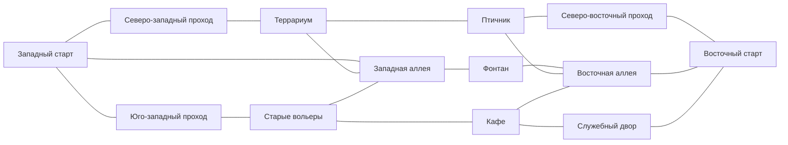

# «Зона Z» — мир, графика и звук

Версия требований и баланса: **1.0.0**, от **3 октября 2026 года**. Уточнения процедурного прототипа: **4 октября 2026 года**. Статус: генераторы карты, моделей, анимаций и синтезированных звуков находятся в `UnityProject/Assets/ZoneZ/Scripts/World`. Первая настоящая Unity-валидация навигации, коллизий и бюджетов пройдена; получены игровые кадры. Художественная приёмка и соответствие целевому FPS ещё не подтверждены. После просмотра кадров исправляются вывески, плотность текстур и листва; изменения требуют повторного рендера.

## 1. Художественная цель и референсы

Заброшенный зоопарк «Последняя смена» должен выглядеть как место с понятной прежней функцией: кассы, указатели, дорожки посетителей, вольеры и технические проходы. Игрок узнаёт место по крупным формам, а затем замечает запустение. Пустая арена с равномерно расставленными ящиками не соответствует задаче.

Цель по впечатлению — близость к Standoff 2: читаемые персонажи и оружие, умеренно реалистичные поверхности, компактная детализация. По уточнению пользователя от 10 октября карта использует более тёмную вечернюю палитру и низкое солнечное освещение. Создаются собственные геометрия, текстуры, рисунки скинов, интерфейс, звуки и анимации. Чужие игровые ресурсы не включаются в поставку.

Референсы и достоверность проверки:

| Источник | Для чего используется | Что проверено 03.10.2026 |
|---|---|---|
| [Официальная страница Standoff 2 в Google Play](https://play.google.com/store/apps/details?id=com.axlebolt.standoff2) | Поиск официальных скриншотов; текущая версия визуального направления | Текст страницы прочитан, ссылки на изображения найдены. Визуальное сравнение самих изображений не выполнено |
| [AXLEBOLT: Reforged — Update 0.30.0](https://help.standoff2.com/en/articles/9805313-reforged-update-0-30-0-description) | Конкретный исторический ориентир окружения Rust; читаемость противников, альтернативные подходы | Текст статьи прочитан; статья датирована 30.08.2024 |
| [Видео, встроенное в официальную статью](https://www.youtube.com/watch?v=iwxyhcBByKA) | Будущее сравнение сцены в движении, масштаба и анимаций | Адрес подтверждён встроенной ссылкой статьи. Получение видео завершилось ошибкой; видео не просмотрено |

В статье AXLEBOLT описаны изменения путей Rust и цветов персонажей ради видимости. Эти положения подтверждают полезность читаемых маршрутов и контраста, но не дают численных параметров материалов или движения. Все численные бюджеты ниже — проектные решения «Зоны Z», а не измерения Standoff 2.

Google Play на дату проверки сообщает об обновлении 26.09.2026, SO2 Remastered и изменениях движения и анимаций. Поэтому Rust из Reforged используется как явно датированный ориентир окружения, а текущая игра не объявляется неизменной копией версии 2024 года. Совпадение «один в один» не считается достигнутым на этапе документации.

### Проверка художественного эталона при разработке

1. Зафиксировать источник, дату и версию каждого сравниваемого кадра. Отобрать дневной открытый участок, затенённый проход, интерьер, вид оружия от первого лица и персонажа на средней дистанции.
2. Просмотреть официальный ролик или доступную запись игрового процесса. Записать таймкоды ходьбы, бега, приседания, прыжка, остановки, стрельбы и перезарядки. Непросмотренный ролик не использовать как доказательство анимационных параметров.
3. Собрать собственный тестовый фрагмент: бетонная стена, деревянная лавка, ограждение, растительность, персонаж и одно оружие. Снять кадры при одинаковом разрешении и близких расстоянии, ракурсе и поле зрения.
4. Сравнить силуэты, насыщенность, яркость теней, резкость текстур, масштаб повреждений поверхностей и размер оружия в кадре. Отдельно сравнить движение камеры и читаемость стрельбы.
5. Записать расхождения и принятые настройки. Утвердить один эталон и только затем распространять материалы на всю карту. Эта проверка сейчас имеет статус «не выполнено».

## 2. План карты

Игровая территория — примерно **160 × 140 м**. Unity: 1 единица = 1 м; X направлен с запада на восток, Z — с юга на север, Y — вверх. Границы рабочего плана: X от −80 до +80, Z от −70 до +70. Высотные ступени и небольшие возвышения допускаются, но не создают обход границ или позиции без второго подхода.

Это исходная схема для серой геометрии, а не финальные координаты готового уровня. Изменения координат после проверки проходимости фиксируются в следующей версии плана; количество стартов и точек лута сохраняется.

Уточнения прототипа 04.10: точка DM18 сдвинута с Z=−27 на −26,6 м от стены кафе, L02 — с Z=+42 на +42,5 м от витрины террариума. Исправленные точки прошли проверку капсулы и связности NavMesh в Unity 6000.3.15f1. X/Z остальных 34 точек сохранены. Высота и небольшое смещение к доступной поверхности уточняются один раз после построения NavMesh, в радиусе не более 0,8 м; отсутствие поверхности считается ошибкой валидации.

| Зона | Центр X/Z, м | Назначение и материалы |
|---|---:|---|
| Западный вход | −68 / 0 | Первая стартовая зона, кассы, бетонные укрытия, три выхода |
| Террариум | −30 / +38 | Северный маршрут, короткие повороты, камень и стекло |
| Птичник | +30 / +38 | Северный маршрут, металлические ограждения и деревянные навесы |
| Центральный фонтан | 0 / 0 | Средний маршрут, главная ориентирующая форма, обход с двух сторон |
| Старые вольеры | −32 / −34 | Южный маршрут, дерево и бетон, короткие дистанции |
| Кафе | +20 / −34 | Южный маршрут, интерьер и открытая терраса |
| Служебный двор | +58 / −34 | Подход к восточному старту, техника и хозяйственные постройки |
| Восточная служебная проходная | +68 / 0 | Вторая стартовая зона, три выхода, бетон и металл |

Схема показывает связи, не длины и не линии видимости. Все три маршрута разделяются стенами и изгибами; противоположные старты друг из друга не видны. Основные проходы имеют свободную ширину 3–5 м, боковые связи — не менее 2 м. Ширина считается после установки коллизий и мебели. Двери на боевых маршрутах в первой версии статичны: открытые проёмы либо закрытые простреливаемые деревянные полотна без механики открывания.

Две длинные линии располагаются на северном внешнем проходе и вдоль южной террасы. Стартовая целевая длина — 40–55 м. Изгибы и глухие укрытия останавливают продолжение линии до стартов. Каждая снайперская позиция имеет боковой подход. Центр и поперечные проходы дают столкновения на 10–30 м, интерьер кафе и вольеры — на 3–12 м. Чрезмерно открытые пересечения исправляются геометрией до художественной детализации.

### Командные старты и Deathmatch

В каждой из двух командных зон размещается **12 отдельных стартовых мест**, сетка 3 × 4 с шагом 2 м вокруг центра зоны. Капсулы не пересекаются. В следующем раунде команды меняются сторонами. Из стартовой зоны есть доступ ко всем трём маршрутам без единственного узкого дверного проёма.

В генераторе X западной сетки: −70, −68, −66 м; восточной: +70, +68, +66 м. Для обеих сеток Z: −3, −1, +1, +3 м. Защитные информационные стенки стоят на X=±61 м, имеют длину 6 м по Z и высоту 2,5 м. Между их крайними столбами и входными ограждениями остаётся около 3 м. В валидатор включены четыре прохода X=±61/Z=±5 и все 144 пары противоположных стартов.

Deathmatch использует **24 фиксированные точки**, две в каждой из 12 микрозон. Указанные координаты — метки для проверки на серой карте; каждая точка должна стоять на доступной поверхности за укрытием и смотреть в сторону выхода из своей ниши.

| Микрозона | Точка A: ID и X/Z | Точка B: ID и X/Z |
|---|---|---|
| Западные кассы | DM01: −67 / −10 | DM02: −67 / +10 |
| Северо-западный проход | DM03: −57 / +35 | DM04: −48 / +49 |
| Террариум | DM05: −34 / +49 | DM06: −20 / +30 |
| Северный переход | DM07: −5 / +49 | DM08: +8 / +32 |
| Птичник | DM09: +27 / +49 | DM10: +39 / +30 |
| Северо-восточный проход | DM11: +54 / +48 | DM12: +63 / +29 |
| Восточная проходная | DM13: +67 / +10 | DM14: +67 / −10 |
| Служебный двор | DM15: +58 / −26 | DM16: +51 / −47 |
| Кафе | DM17: +31 / −43 | DM18: +14 / −26,6 |
| Южный переход | DM19: 0 / −48 | DM20: −14 / −29 |
| Старые вольеры | DM21: −29 / −47 | DM22: −43 / −29 |
| Юго-западный проход | DM23: −59 / −43 | DM24: −58 / −20 |

Выбор безопасной точки выполняет логика режима: учитываются видимость и расстояние до живых противников. Художественное оформление не должно прятать плохой старт растительностью, сквозь которую противник всё равно видит игрока. Если все точки опасны, применяется предусмотренная правилами защита возрождения; новая несуществующая точка внутри стен не создаётся.

### Точки лута

На карте **12 точек**; в Deathmatch в волне активны шесть. Расписание и эффекты определены в [документе способностей](03_ABILITIES_AND_LOOT.md). В командном бою лут отсутствует.

| ID | X/Z, м | Место |
|---|---:|---|
| L01 | −47 / +30 | Западный подход к террариуму |
| L02 | −24 / +42,5 | Проход за восточной витриной террариума |
| L03 | +3 / +40 | Северное пересечение |
| L04 | +29 / +42 | У северного прохода птичника |
| L05 | +50 / +22 | Восточный северный подход |
| L06 | +37 / 0 | За укрытием восточной аллеи |
| L07 | +46 / −31 | Между кафе и служебным двором |
| L08 | +18 / −39 | У южного выхода кафе |
| L09 | −4 / −36 | Южное пересечение |
| L10 | −32 / −39 | Проход старых вольеров |
| L11 | −49 / −19 | Западный южный подход |
| L12 | −29 / 0 | За укрытием западной аллеи |

Лут стоит на земле, доступен без прыжковой головоломки и не требует остановки в единственном простреливаемом центре. Видимая модель и зона взаимодействия совпадают по положению. Подсветка показывает доступный предмет, но не просвечивает сплошные стены.

## 3. Материалы, свет и коллизии

Палитра: тёплый серый бетон, выцветшая охра указателей, тёмная зелень растений, локальная ржавчина и светлое старое дерево. Командные акценты на персонажах отделяются от фона по светлоте и цвету. Тёмный персонаж не должен исчезать в тёмном дверном проёме.

Текущее освещение — поздний день: один тёплый направленный источник, мягкие тени, холодное рассеянное освещение и затенение близких поверхностей SSAO. Цветокоррекция ACES и фиксированная экспозиция приглушают яркость и насыщенность. Туман начинается на 110 м и скрывает дальний фон. Запечённое непрямое освещение и зонды остаются дальнейшей целью. Сильные motion blur, глубина резкости в бою и автоматически скачущая экспозиция отключены.

| Материал | Движение | Пули | Звук и визуальный отклик |
|---|---|---|---|
| Дерево, включая стволы | Блокирует | Проходят с потерей урона по правилам боя | Щепки, глухой удар |
| Металл, бетон, камень | Блокирует | Останавливаются | Короткая искра либо пыль, соответствующий удар |
| Целое стекло | Блокирует | Останавливаются | Звук попадания, видимая трещина; не разрушается |
| Пол и грунт | Поддерживает персонажа | Останавливаются | Шаги по типу поверхности |
| Листья и трава без твёрдой геометрии | Не являются стеной | Не создают препятствия | Небольшой шорох; не скрывают хитбокс |

Правила проекта намеренно задают непробиваемое стекло. Оно изображается как толстое остекление вольеров, чтобы поведение читалось зрительно. Сетка ограждения имеет совпадающие с изображением отверстия: луч сквозь пустоту не считается попаданием в металл, а луч в прут останавливается. Коллизия для ходьбы не пропускает капсулу сквозь ограждение.

Каждый твёрдый объект имеет коллизию движения. Материал прострела назначается физической поверхности, а не определяется цветом текстуры. У деревянного ящика и металлической стойки отдельные поверхности: дерево не делает стойку пробиваемой. Декоративные фаски не создают невидимые зацепы ног. Закрытые задники и границы имеют явные ограждения; отсутствуют невидимые проходы в декорации.

## 4. Животные и жизнь окружения

Всего **девять живых животных**: две белки, две крысы, одна черепаха, четыре голубя. Дополнительно два небольших неподвижных останка в закрытых вольерах, без подробных повреждений. Животные не дают убийств, очков, валюты или заряда ульты.

По уточнению пользователя от 10 октября белки, крысы и черепаха живут на свободе на общественных дорожках и газонах; три их прежних закрытых вольера удалены. Они следуют доступным маршрутам NavMesh с остановками и обходом препятствий. Белки и крысы ускоряются при близком выстреле, черепаха медленно отходит дальше от шума. Проверки и кадры актуальной карты — в [MAP_UPDATE_REPORT.md](MAP_UPDATE_REPORT.md).

| Вид | Поведение | Минимальные анимации |
|---|---|---|
| Белка × 2 | Короткие переходы по краям сада, бегство к дереву от близкого шума | Ожидание, бег, настороженность |
| Крыса × 2 | Переход между укрытиями возле служебного двора | Ожидание, бег, разворот |
| Черепаха × 1 | Медленное движение в ограждённой периферийной зоне | Ожидание, ходьба |
| Голубь × 4 | Небольшая группа у птичника, взлёт и возвращение после шума | Ожидание, шаги, взлёт, полёт, посадка |

Проектное допущение первой версии: животные размещаются в отделённых от игроков периферийных участках и не участвуют в системе боевого урона. Их маршруты не перекрывают человеческие проходы, старты, точки лута и обзор основных линий. Шум вызывает реакцию через отдельную упрощённую систему, без полного боевого ИИ. Вылетающие голуби не создают коллизию препятствия в траектории игрока.

## 5. Перечень ресурсов и требования

| Группа | Обязательный состав |
|---|---|
| Персонажи | Два визуальных комплекта команд на общем скелете; собственные руки от первого лица; единые боевые хитбоксы |
| Оружие | 34 огнестрельные модели, Zeus и базовый нож; подробный вид от первого лица и облегчённый вид в мире |
| Ульты | Граната, ЭМИ-граната, подствольник, лазерное оружие, ракетомёт и ракета; эффекты остальных способностей |
| Лут | Шесть различимых моделей или знаков над подбираемыми предметами; общий постамент/маркер |
| Архитектура | Кассы, стены и крыши павильонов, кафе, служебный корпус, фонтан, вольерные модули, двери и навесы |
| Мебель и детали | Деревянные лавки/ящики, металлические ограждения/урны, указатели, остатки вывесок, небольшие группы мусора |
| Природа | Два варианта деревьев, кустарник, трава; четыре вида живых животных и два небольших объекта останков |
| Скины | Маски трёх цветовых зон для каждого поддерживаемого оружия, UV-развёртка узора, четыре области наклеек |
| Боевые эффекты | Вспышки, гильзы, следы попаданий по материалам, взрыв, щит, лечение, ускорение, разведка и ЭМИ |

Необходимые анимации персонажа: ожидание; движение вперёд, назад и в стороны; ходьба; приседание и движение сидя; прыжок и приземление; стрельба; перезарядка; смена оружия; получение урона; смерть. Скорость цикла синхронизируется с действительным перемещением, чтобы ноги не скользили. Бонусы скорости изменяют перемещение и частоту соответствующего цикла согласованно.

Для каждого оружия первого лица: появление, ожидание, выстрел, перезарядка с остатком патронов, пустая перезарядка, осмотр, уборка. Альтернативный режим получает отдельную анимацию, если он меняет хват, прицел или глушитель. Для ножа и Zeus — собственные действия по боевой спецификации. Визуальные события магазина и выстрела привязаны к событиям симуляции; отменённая анимация не добавляет патроны сама.

Для каждого ресурса при производстве фиксировать ID, автора/происхождение, исходный файл, экспорт, материал, размеры, число треугольников, LOD и статус проверки. Исходники Blender и текстур сохраняются вместе с проектом разработки. В текущем прототипе собственные модели, узоры скинов и резервные поверхности собираются из C# во время запуска; отдельных Blender-исходников и экспортированных модельных файлов пока нет. В `Resources/Textures` подключаются оригинальные растровые материалы, созданные imagegen для этого проекта: `weathered-concrete`, `worn-asphalt`, `weathered-timber`, `dry-park-ground`, `oak-foliage`. При отсутствии картинки остаётся процедурная поверхность. Наличие генераторов не заменяет визуальную приёмку.

Архитектурные UV зависят от физических размеров геометрии: бетон 2 м на тайл, дорожки и дерево 3 м, грунт 4 м. Общие материалы сохраняются; отдельная UV-развёртка кэшируется по форме и размерам. Сфера использует плотность по окружности и меридиану, цилиндр — по окружности и высоте. Крона дерева при наличии прозрачной текстуры состоит из 28 групп по три пересекающиеся плоскости, объединённых в один меш: 168 треугольников и один рендерер. На 29 деревьев используются шесть вариантов общего меша и один непрозрачный материал с отсечением альфы; коллизии остаются только у деревянных частей.

Вывески используют собственный `Zone Z/World Sign`: проверку глубины `LEqual` и отсечение обратной стороны. Общий материал следит за перестроением атласа кириллического шрифта. У крупных коробчатых деталей оружия добавлены фаски до 5 мм, 44 треугольника вместо 12 на деталь; исходные габариты и анимационные узлы сохраняются. После изменений материала и геометрии обязательна проверка реального кадра.

## 6. Звук

Выстрелы имеют варианты по оружию, короткий ближний удар и облегченное дальнее представление. Для автоматической стрельбы переход начала, цикла и окончания не должен давать слышимые щелчки. Глушитель меняет характер звука, а расстояние слышимости задаётся боевой системой, не громкостью устройства пользователя.

Минимальный набор: выстрел/пустой спуск, операции перезарядки и смены оружия; шаги по бетону, дереву, металлу и грунту; прыжок/приземление; попадания по четырём твёрдым материалам; попадание по игроку и подтверждение убийства; десять отличимых сигналов ульт; подбор шести видов лута; начало/окончание раунда, последние секунды, победа/поражение; действия меню и покупки; ветер, птицы и редкий скрип вывесок.

Боевые звуки получают приоритет перед фоном. Окклюзия стен приглушает звук и сохраняет направление; союзные шаги не маскируют полностью близкий выстрел противника. События слышимости для ботов возникают из симуляции независимо от настроек звука. В прототипе собственный тихий 16-секундный гармонический цикл звучит только в меню и останавливается при переходе к подготовке, бою или итогам. Ни одно обязательное состояние не передаётся только звуком.

## 7. Бюджеты и приёмка

Это стартовые **проектные бюджеты**, а не результаты измерений готовой игры:

| Показатель | Начальный бюджет |
|---|---|
| Целевой компьютер | GTX 1650, Ryzen 5 3600, 16 ГБ RAM |
| Целевой режим | 1920 × 1080, среднее качество, 24 участника, 60 FPS |
| Персонаж в мире | До 25 тыс. треугольников LOD0; упрощённые LOD1/LOD2 |
| Оружие первого лица / в мире | До 35 тыс. / 8 тыс. треугольников LOD0 |
| Текстуры | До 2048 для оружия и героя; обычно 1024 для повторяемого окружения; 512 для мелких деталей |
| Свет | Один главный источник с тенями; запечённый свет статического окружения |
| Эффекты | Пулы повторно используемых объектов; ограничение длительности декалей и частиц |

До художественного наполнения проверить навигацию каждого маршрута для 24 участников. После наполнения измерить наиболее тяжёлые кадры у фонтана и при нескольких одновременно активных способностях. Уменьшение качества не отключает коллизии, не делает стены прозрачными и не убирает функциональные укрытия.

Приёмка карты: 24 командных стартовых места и 24 точки Deathmatch не пересекают геометрию; 12 точек лута доступны; у каждой основной позиции два подхода; две длинные линии не смотрят в стартовые ниши; деревянные и недеревянные поверхности соответствуют правилам; персонажи различимы в тени; животные не вмешиваются в бой; звуки позволяют различать ключевые события. Художественное сходство со Standoff 2 принимается по будущему сравнительному эталону, а не по наличию ссылок на референсы.

### Проверки процедурного прототипа

`ZoneZ.Editor.WorldValidation.Run()` строит временную сцену без запуска игрового цикла. Проверяет 48 стартов и 12 точек лута на NavMesh, связность, пересечение с твёрдой геометрией и взаимное пересечение капсул; наличие SurfaceTag; защиту командных стартов от прямого обзора; девять животных и два останка; 36 различных наборов деталей оружия и три временных оружия. Дополнительно проверяет лицевую сторону вывесок, UV-плотность грунта и число крон. Печатает количество треугольников, рендереров и общих материалов. В режиме `-batchmode -nographics` не рендерит кадры и не синтезирует фоновые аудиоклипы. Если интерактивный Editor содержит несохранённую безымянную сцену, валидатор останавливается до изменений; он не сохраняет и не закрывает пользовательские сцены. Batch-оркестратор предварительно открывает сохранённую Boot-сцену.

Сейчас свет задаётся направленным источником и окружающим освещением; запечённое освещение и световые зонды ещё не созданы. Листва не участвует в коллизиях; цилиндрические твёрдые объекты используют коллизию по мешу, чтобы плоское основание фонтана не превращалось в невидимую капсулу. Мелкая архитектура объединяется статически, крупные повторяющиеся кроны остаются отдельными; детали персонажа и оружия объединяются внутри подвижных узлов. Эти меры ещё не являются результатом измерения производительности.
